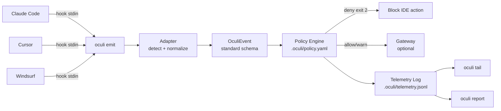

# Oculi Security

Oculi is a security layer for AI coding agents. It intercepts hook events from IDEs like Cursor, Claude Code, and Windsurf, normalizes them into a standard schema (`OculiEvent`), evaluates them against local policy rules, logs everything to a local telemetry file, and optionally forwards to a central gateway for org-wide policy enforcement. Every event — shell commands, file reads/edits, MCP tool calls — goes through the same pipeline regardless of which IDE generated it.

## Architecture



## Quick Start — Cursor

```bash
npm install -g oculi-security
cd your-project
oculi init standard
oculi install cursor
```

> **Not on npm yet?** See [Local Install](#local-install) below.

This creates `.oculi/policy.yaml` with sensible defaults (blocks `rm -rf`, path traversal; warns on `.env` access and MCP calls) and registers Oculi hooks in `.cursor/hooks.json` for all five Cursor hook events.

## Quick Start — Claude Code

```bash
npm install -g oculi-security
cd your-project
oculi init standard
oculi install claude-code
```

> **Not on npm yet?** See [Local Install](#local-install) below.

Registers hooks in `.claude/settings.json` for `PreToolUse`, `PostToolUse`, and `Stop` events.

## Viewing Telemetry

Every intercepted event is logged to `.oculi/telemetry.jsonl` as a single JSON line (rotated at 10 MB, 5 rotations max).

### Live stream

```bash
oculi tail
```

```
[14:32:01] PRE  | shell      | npm test                 | ✅ allow
[14:32:05] PRE  | shell      | rm -rf /                 | 🚫 deny (no-rm-rf)
[14:32:08] POST | file_edit  | src/auth.ts              | ✅ allow
[14:32:10] PRE  | file_read  | .env.local               | ⚠️  warn (warn-env-access)
```

Filter to only violations:

```bash
oculi tail --filter deny
```

### Summary report

```bash
oculi report              # human-readable, last 24h
oculi report --hours 48   # look back further
oculi report --json       # machine-readable
```

```
Oculi Report — last 24 hours (2026-03-04 14:32 → 2026-03-05 14:32)

Events: 142 total (98 pre, 40 post, 4 complete)

By tool:
  shell          52  ████████████████
  file_read      38  ████████████
  file_edit      31  ██████████
  mcp_call       17  █████

By IDE:
  claude-code    89 (63%)
  cursor         53 (37%)

Policy violations (2):
  2026-03-05 14:32:05  deny  shell     rm -rf /       no-rm-rf
  2026-03-05 13:15:22  warn  file_read .env.local     warn-env-access
```

## Policy Configuration

Policy rules live in `.oculi/policy.yaml`. Oculi walks up from the current directory to find the nearest one, falling back to `~/.oculi/policy.yaml`.

### Rule format

```yaml
rules:
  - id: "rule-name"
    match:
      tool: shell | file_read | file_edit | mcp_call   # exact match
      command_pattern: "regex"    # tested against shell commands
      file_pattern: "regex"       # tested against file paths
      mcp_server: "server-name"   # exact match on MCP server
    action: deny | warn | allow
```

All `match` fields are AND-ed. When multiple rules match, precedence is **deny > warn > allow**. Policy is only evaluated on `pre` phase events.

### Templates

Generate a starter policy with `oculi init <template>`:

| Template | Behavior |
|----------|----------|
| `minimal` | Empty rules — logs everything, blocks nothing |
| `standard` | Blocks `rm -rf` and path traversal, warns on `.env` and MCP |
| `strict` | Deny-all for shell/MCP, explicit allowlist for safe commands and file ops |

### Standard template (recommended starting point)

```yaml
rules:
  - id: "no-rm-rf"
    match:
      tool: shell
      command_pattern: "rm\\s+-rf"
    action: deny

  - id: "no-path-traversal"
    match:
      tool: shell
      command_pattern: "\\.\\./"
    action: deny

  - id: "warn-env-access"
    match:
      tool: file_read
      file_pattern: ".env"
    action: warn

  - id: "warn-env-edit"
    match:
      tool: file_edit
      file_pattern: ".env"
    action: warn

  - id: "warn-mcp"
    match:
      tool: mcp_call
    action: warn
```

### Exit codes

| Code | Meaning |
|------|---------|
| `0` | Allowed (or gateway unreachable — fail-open) |
| `1` | Error (bad input, unknown adapter) |
| `2` | Denied by policy |

## CLI Reference

```
oculi emit [adapter]                          # read stdin, evaluate policy, forward to gateway
oculi install <cursor|claude-code> [--global] [--dry-run]
oculi uninstall <cursor|claude-code> [--global] [--dry-run]
oculi init <minimal|standard|strict>          # create .oculi/policy.yaml
oculi tail [--filter <allow|warn|deny>] [--no-color]
oculi report [--json] [--hours N]
```

Environment variables (emit only):
- `GATEWAY_URL` — Base URL of the Oculi gateway (default: `http://localhost:3000`)
- `GATEWAY_TOKEN` — Bearer token for gateway auth (optional)

## Gateway Server

The gateway is an optional central component for org-wide policy enforcement, JWT auth, rate limiting, and audit logging.

```bash
# Local dev
cd apps/gateway && npm run dev

# Full stack with Docker (gateway + OPA + upstreams)
docker compose up --build

# Admin UI
open http://localhost:3000/admin
```

See [Architecture](docs/ARCHITECTURE.md), [Threat Model](docs/THREAT_MODEL.md), [How-To Guide](docs/HOW_TO.md), and [OPA Policy Reference](policies/README.md) for gateway details.

## Adding Support for New IDEs

Every IDE adapter implements the `HookAdapter` interface:

```typescript
interface HookAdapter {
  /** Return true if this payload came from your IDE. */
  detect(body: Record<string, unknown>): boolean;

  /** Parse the raw payload into a standard OculiEvent. */
  normalize(body: Record<string, unknown>): OculiEvent;

  /** Format the "allowed" response in your IDE's expected format. */
  formatAllow(): string;

  /** Format the "denied" response in your IDE's expected format. */
  formatDeny(reason: string): string;

  /** HTTP status code for deny (200 for most IDEs, 403 for Windsurf). */
  denyStatusCode(): number;
}
```

To add a new IDE:

1. Create `apps/gateway/src/routes/adapters/<ide-name>.ts` implementing the five functions above
2. Register it in `apps/gateway/src/routes/adapters/router.ts` by adding to `ADAPTER_REGISTRY`
3. Create `apps/gateway/src/install/<ide-name>.ts` with `install` and `uninstall` functions that manage the IDE's hook config file
4. Add the target to `SUPPORTED_TARGETS` in `apps/gateway/src/cli.ts`

The key contract: `normalize()` must produce an `OculiEvent` where `tool` is one of the standard names (`shell`, `file_read`, `file_edit`, `mcp_call`, `session_stop`) and `shell_command`, `file_path`, `mcp_server` are populated for the relevant tool type. This ensures policy rules and telemetry work identically regardless of IDE.

Existing adapters: **Claude Code**, **Cursor**, **Windsurf** (all in `apps/gateway/src/routes/adapters/`).

## Development

### Local Install

The `oculi` CLI isn't published to npm yet. To use it locally:

```bash
cd apps/gateway
npm install
npm run build
npm link
```

This compiles TypeScript to `dist/` and symlinks the `oculi` binary onto your PATH. After this, the Quick Start commands (`oculi init`, `oculi install`) will work.

### Commands

```bash
cd apps/gateway
npm test              # 234 tests across 11 files
npm run dev           # gateway server with hot reload
npm run build         # compile to dist/
```

## Design Partners

We're looking for teams using AI coding agents (Cursor, Claude Code, Windsurf) who want visibility and control over what those agents do in their codebase. If you're interested in trying Oculi or have feedback on the policy model, reach out — we're actively iterating based on real-world usage.
