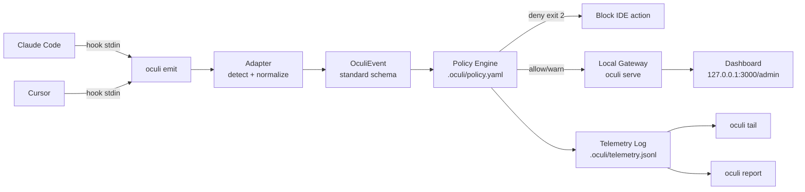

# Oculi Security

Oculi is a security layer for AI coding agents. It intercepts hook events from IDEs like Cursor and Claude Code, normalizes them into a standard schema (`OculiEvent`), evaluates them against local policy rules, and logs everything to a local telemetry file. Every event — shell commands, file reads/edits, MCP tool calls — goes through the same pipeline regardless of which IDE generated it.

## Architecture



## Quick Start

```bash
npm install -g oculi-security
cd your-project
oculi init
```

`oculi init` auto-detects installed agents (Claude Code, Cursor) on your PATH and wires hooks for each. It also writes `.oculi/policy.yaml` with sensible defaults (blocks `rm -rf`, path traversal; warns on `.env` access and MCP calls).

Wire only one agent:

```bash
oculi init --agent claude-code
oculi init --agent cursor
```

Idempotent — safe to re-run. Existing user-authored hooks are preserved.

## Viewing Telemetry

Every intercepted event is logged to `.oculi/telemetry.jsonl` as a single JSON line (rotated at 10 MB, 5 rotations max).

### Live stream

```bash
oculi tail
```

```
[14:32:01] PRE  | shell      | npm test                 | ✅ allow
[14:32:05] PRE  | shell      | rm -rf /                 | 🚫 deny (no-rm-rf)
[14:32:08] POST | file_edit  | src/auth.ts              | ✅ allow
[14:32:10] PRE  | file_read  | .env.local               | ⚠️  warn (warn-env-access)
```

Filter to only violations:

```bash
oculi tail --filter deny
```

### Summary report

```bash
oculi report              # human-readable, last 24h
oculi report --hours 48   # look back further
oculi report --json       # machine-readable
```

### Dashboard

```bash
oculi serve               # start the local gateway + dashboard at 127.0.0.1:3000
```

Open `http://127.0.0.1:3000/admin` for a live view of events, decisions, and policy violations.

## Policy Configuration

Policy rules live in `.oculi/policy.yaml`. Oculi walks up from the current directory to find the nearest one.

### Rule format

```yaml
rules:
  - id: "rule-name"
    match:
      tool: shell | file_read | file_edit | mcp_call   # exact match
      command_pattern: "regex"    # tested against shell commands
      file_pattern: "regex"       # tested against file paths
      mcp_server: "server-name"   # exact match on MCP server
    action: deny | warn | allow
```

All `match` fields are AND-ed. When multiple rules match, precedence is **deny > warn > allow**. Policy is only evaluated on `pre` phase events.

### Standard policy (what `oculi init` writes)

```yaml
rules:
  - id: "no-rm-rf"
    match:
      tool: shell
      command_pattern: "rm\\s+-rf"
    action: deny

  - id: "no-path-traversal"
    match:
      tool: shell
      command_pattern: "\\.\\./"
    action: deny

  - id: "warn-env-access"
    match:
      tool: file_read
      file_pattern: ".env"
    action: warn

  - id: "warn-env-edit"
    match:
      tool: file_edit
      file_pattern: ".env"
    action: warn

  - id: "warn-mcp"
    match:
      tool: mcp_call
    action: warn
```

### Exit codes

| Code | Meaning |
|------|---------|
| `0` | Allowed (or gateway unreachable — fail-open) |
| `1` | Error (bad input, unknown adapter) |
| `2` | Denied by policy |

## Removing Oculi

```bash
oculi uninstall                  # remove all Oculi state from this project
oculi uninstall --agent cursor   # remove only Cursor's hooks
```

`oculi uninstall` removes the hook entries Oculi added to `.claude/settings.json` / `.cursor/hooks.json`, preserves your own hooks, and removes `.oculi/policy.yaml` when no agent has Oculi hooks remaining.

## CLI Reference

```
oculi init [--agent <name>]            # write policy + wire detected agent hooks
oculi uninstall [--agent <name>]       # remove Oculi state from this project
oculi serve [options]                  # start local gateway + dashboard
oculi tail [--filter <action>]         # live-stream telemetry log
oculi report [--json] [--hours N]      # summarize recent events
oculi emit [adapter]                   # read stdin, evaluate policy (called by IDEs)
```

Run `oculi <command> --help` for command-specific options.

Environment variables (emit only):
- `GATEWAY_URL` — Base URL of the Oculi gateway (default: `http://localhost:3000`)
- `GATEWAY_TOKEN` — Bearer token for gateway auth (optional)

## Adding Support for New IDEs

Every IDE adapter implements the `HookAdapter` interface:

```typescript
interface HookAdapter {
  /** Return true if this payload came from your IDE. */
  detect(body: Record<string, unknown>): boolean;

  /** Parse the raw payload into a standard OculiEvent. */
  normalize(body: Record<string, unknown>): OculiEvent;

  /** Format the "allowed" response in your IDE's expected format. */
  formatAllow(): string;

  /** Format the "denied" response in your IDE's expected format. */
  formatDeny(reason: string): string;

  /** HTTP status code for deny (200 for most IDEs, 403 for Windsurf). */
  denyStatusCode(): number;
}
```

To add a new IDE:

1. Create `apps/gateway/src/routes/adapters/<ide-name>.ts` implementing the five functions above.
2. Register it in `apps/gateway/src/routes/adapters/router.ts` by adding to `ADAPTER_REGISTRY`.
3. Create `apps/gateway/src/install/<ide-name>.ts` with `installX` / `uninstallX` / `hasOculiHooks` functions.
4. Add the agent name to `AGENTS` in `apps/gateway/src/install/detect.ts` and the binary name to `BINARIES`.
5. Wire it into the orchestrators in `apps/gateway/src/commands/init.ts` and `apps/gateway/src/commands/uninstall.ts`.

The key contract: `normalize()` must produce an `OculiEvent` where `tool` is one of the standard names (`shell`, `file_read`, `file_edit`, `mcp_call`, `session_stop`) and `shell_command`, `file_path`, `mcp_server` are populated for the relevant tool type. This ensures policy rules and telemetry work identically regardless of IDE.

Existing adapters: **Claude Code**, **Cursor**, **Windsurf** (all in `apps/gateway/src/routes/adapters/`).

## Development

### Local Install

```bash
cd apps/gateway
npm install
npm run build
npm link
```

This compiles TypeScript to `dist/` and symlinks the `oculi` binary onto your PATH.

### Commands

```bash
cd apps/gateway
npm test              # full unit + integration suite
npm run dev           # gateway server with hot reload
npm run build         # compile to dist/
```

## Design Partners

We're looking for teams using AI coding agents (Cursor, Claude Code, Windsurf) who want visibility and control over what those agents do in their codebase. If you're interested in trying Oculi or have feedback on the policy model, reach out — we're actively iterating based on real-world usage.
